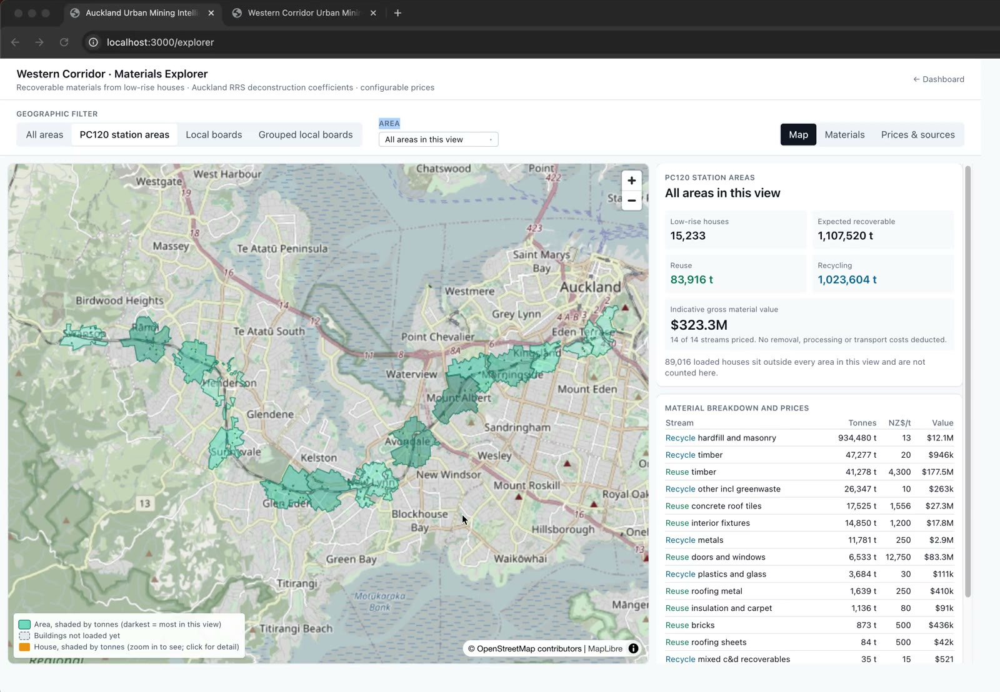

# Western Corridor Urban Mining

**Live page: https://sushenghua.github.io/BrownyHackathonUrbanMining/**

A Council-facing tool that shows how much building material could be recovered from houses along Auckland's Western Rail Corridor, and what it's worth, before those houses become waste.

Built in one day at the Auckland CivicTech Hackathon (October 2026), Waste challenge: construction and demolition materials. I worked as a full-stack developer in a team of 6.

## The problem
- Auckland's houses hold large amounts of reusable timber, roofing, bricks, metals, doors and windows, but nobody can see how much exists or where it is, so most of it ends up as demolition waste.
- Recovery is usually judged house by house. Council and industry need a neighbourhood- and corridor-level view to make the case for deconstruction over demolition.

## Our solution
- **Materials Explorer:** an interactive map of the corridor. Pick a station catchment, local board or ward and see expected recoverable materials by type (reuse vs recycling) with an indicative market value. Zoom in to any single house.
- **Open API:** every number is also available as JSON or GeoJSON for use in other tools.

**Built with:** Next.js, TypeScript, Tailwind CSS, MapLibre, FastAPI, Python, PostgreSQL + PostGIS, Docker.

[Watch the demo video](assets/demo.mp4)
